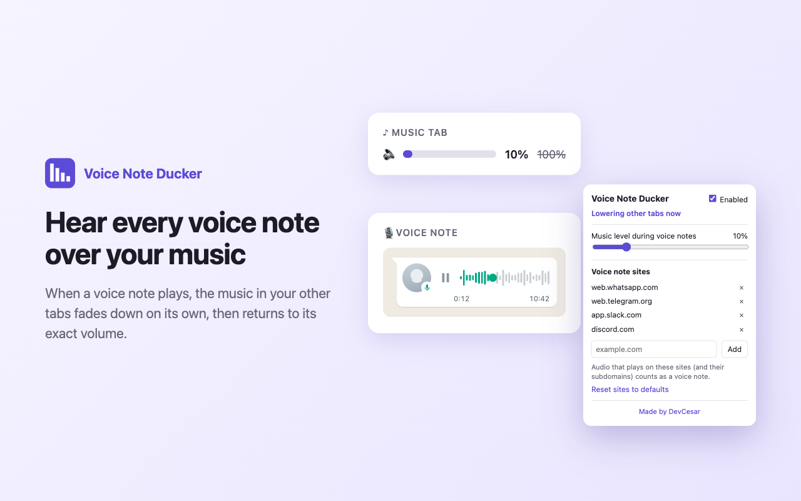
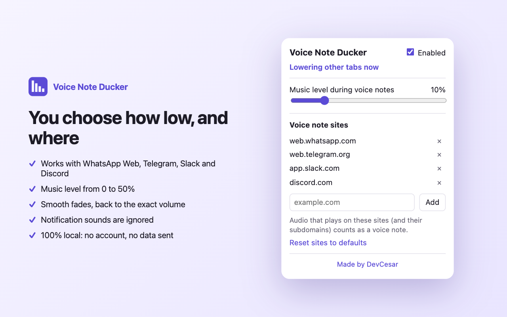
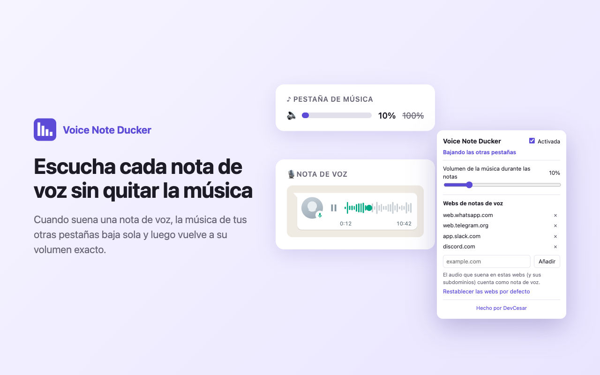
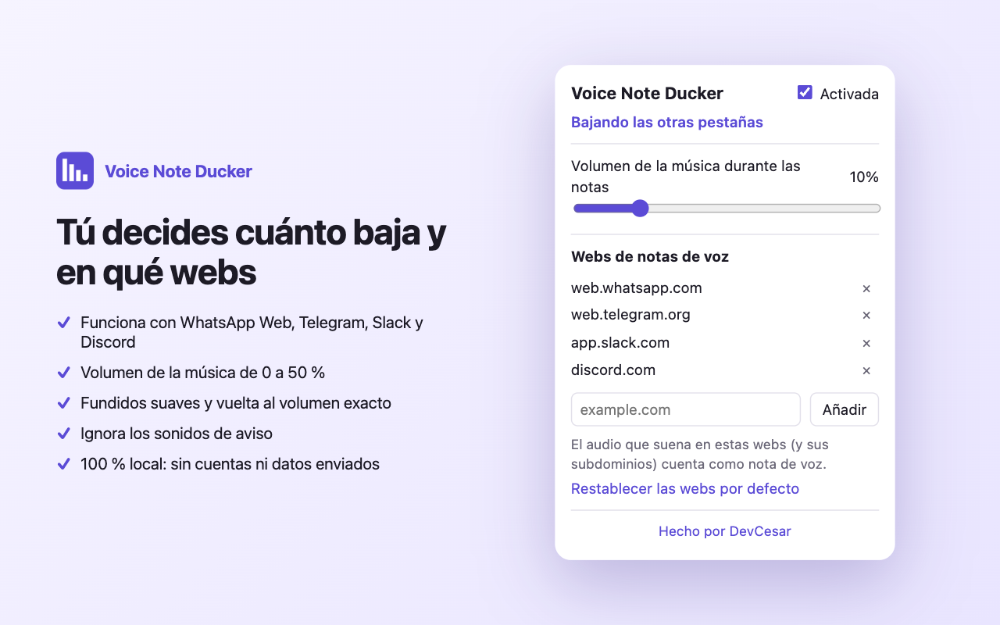

**English** · [Español](#español)

## Hear every voice note over your music

Voice Note Ducker is a browser extension for Chrome, Edge and Brave. When a voice note plays on
WhatsApp Web, Telegram, Slack or Discord, it fades down the music and videos in your other tabs
(YouTube, Spotify Web, any audio or video). When the voice note ends, they fade back to their exact
volume.

- Several voice notes in a row keep the music low, with no jumps in between.
- Notification sounds are ignored.
- If you change a player's volume by hand while it's lowered, your choice is kept.
- You choose how low the music goes (0–50%) and which sites count as voice note sites.
- 100% local: no account, no analytics, no network requests. [Privacy policy](privacy-policy).

Made by [DevCesar](https://www.linkedin.com/in/devrequena-developer/) ·
[Source code](https://github.com/DevRequena/voice-note-ducker)

---

## Español

### Escucha cada nota de voz sin quitar la música

Voice Note Ducker es una extensión para Chrome, Edge y Brave. Cuando suena una nota de voz en
WhatsApp Web, Telegram, Slack o Discord, baja suavemente la música y los vídeos de tus otras
pestañas (YouTube, Spotify Web, cualquier audio o vídeo). Cuando la nota termina, vuelven poco a
poco a su volumen exacto.

- Varias notas seguidas: la música se queda baja todo el rato, sin subidas entre una y otra.
- Ignora los sonidos de aviso.
- Si cambias a mano el volumen de un reproductor mientras está bajado, se respeta tu cambio.
- Tú eliges cuánto baja la música (0–50 %) y qué webs cuentan como webs de notas de voz.
- 100 % local: sin cuentas, sin estadísticas y sin conexiones a internet. [Política de privacidad](privacy-policy).

Hecho por [DevCesar](https://www.linkedin.com/in/devrequena-developer/) ·
[Código fuente](https://github.com/DevRequena/voice-note-ducker)
